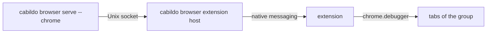

# The agent browser

Run `cabildo browser` to see and manage the browser that your agents use. Every agent session
starts its own visible Chrome, so these commands show what is running and keep it healthy.

## Commands

```bash
cabildo browser status
```

Lists the browser servers and the Chrome processes under them, with age and memory. Also shows
whether the saved login is empty or old.

```bash
cabildo browser reap --dry-run
cabildo browser reap
```

Stops the servers whose Claude session is gone, and Chrome processes that lost their server.
`--dry-run` only lists them. `--all` also stops servers of live sessions, except the one that runs
the command; add `--include-mine` to stop that one too.

```bash
cabildo browser login
```

Opens the profile that holds your logins in plain Chrome, with no automation flag, so Google
sign-in works. Log into your sites, then close the window. A second window then opens and closes
by itself: it reads the cookies. They go to the storage-state file with mode 600, and new agent
browsers start from it. Running agent browsers add the new cookies on their next tool call.

The file is `--storage-state` of the `cabildo-browser` entry, or
`~/.claude/mcp-servers/playwright/storage-state.json` when there is none. To save somewhere else,
pass `--storage-state PATH` to `cabildo browser login`.

A login that an agent browser makes can be kept too. After you log in in that window (two-step
verification included), the agent calls `browser_save_logins(["splitwise.com"])`. Only cookies of
the named domains are merged into the file, under a lock, so browsers that run at the same time
do not overwrite each other. The first page result of a server also says when the file is missing,
empty or older than 30 days.

```bash
cabildo browser doctor
```

Reads the `cabildo-browser` entry in `~/.claude.json` and exits 1 if it breaks a rule:

- `--isolated` must be set, so no two agents share a profile lock.
- `--user-data-dir` must not be set.
- Nothing may turn headless on: not `--headless`, not an environment variable, not a config file.

## Use cabildo as the browser server

`cabildo browser serve` is an MCP server built on the Python Playwright package. To use it, set
the `cabildo-browser` entry in `~/.claude.json` to:

```json
{
  "command": "cabildo",
  "args": ["browser", "serve", "--isolated", "--storage-state", "/home/you/.claude/mcp-servers/playwright/storage-state.json"]
}
```

The server starts Chrome on the first tool call. It has no headless mode: `--headless` and
`--user-data-dir` are refused.

It offers these tools: `browser_navigate`, `browser_navigate_back`, `browser_snapshot`,
`browser_click`, `browser_type`, `browser_fill_form`, `browser_press_key`, `browser_hover`,
`browser_select_option`, `browser_take_screenshot`, `browser_evaluate`, `browser_wait_for`,
`browser_tabs`, `browser_console_messages`, `browser_network_requests`, `browser_handle_dialog`,
`browser_file_upload`, `browser_resize`, `browser_login`, `browser_save_logins` and
`browser_close`. Parameter names are snake_case, for
example `double_click` and `full_page`.

Not available yet: `browser_drag`, `browser_drop`, `browser_find`, `browser_network_request` and
`browser_run_code_unsafe`.

## Use your own Chrome

The cabildo extension lets agents use tabs of the Chrome you already work in, with your logins.
No browser is started, and no network port is opened for Chrome.

1. Install the local side. It prints the two steps that follow:

    ```bash
    cabildo browser extension install
    ```

2. In Chrome, open `chrome://extensions`, turn on **Developer mode**, press **Load unpacked** and
   pick the folder that step 1 printed.

3. Give agents the tools, as the `cabildo-chrome` server:

    ```bash
    claude mcp add --scope user cabildo-chrome -- cabildo browser serve --chrome
    ```

The tools have the same names as those of `cabildo-browser`. Agents open their tabs in a green
tab group named `cabildo`, in a window that holds shared tabs only.

To share a tab you already have open, open it, click the extension's icon and press
**Share this tab**, or drag it into the group. To stop, press `×` beside it in the popup.

### What an agent can reach

The extension checks these on every command. Chrome itself does not: the extension's `debugger`
permission covers every tab.

- Tabs: only those of a tab group named `cabildo`. Any group with that name counts, also one you
  made for something else, or one Chrome synced from another computer. A link opened from a
  shared tab joins the group.
- Pages: web pages only. `file:`, `chrome:` and extension pages are refused.
- Sites: any, in those tabs. An agent can open your bank in a shared tab, and you are signed in
  there.
- Cookies: the DevTools commands that read them are refused, and cookie headers are removed from
  what Chrome reports about requests. A script in a shared tab reads what the page can read.
- Files: `browser_file_upload` can give a page any file your user can read.
- Other extensions: a script an agent runs in a shared tab can also run where another extension's
  scripts run in that page, such as a password manager's.
- Programs: any program that runs as your user can connect to the extension, not only cabildo.

To stop agents, turn the switch in the popup off. Chrome shows a "started debugging this browser"
bar while an agent is connected; its **Cancel** button turns the switch off too.

`cabildo browser extension status` says whether it is installed and connected. The popup shows
why it is not connected.

### How it connects



Chrome starts the host when the extension connects. The socket is
`~/.cabildo/chrome/host-<pid>.sock`, readable by your user only. Playwright, in the browser
server, connects to a WebSocket on a random local port and path for that one process.

### Limits

- One agent uses your Chrome at a time. A second one is told who holds it.
- One Chrome profile at a time. With the extension on in two, agents are told to turn one off.
- Linux and macOS. Chrome and Chromium, version 125 or later.
- `browser_resize` and `browser_save_logins` are refused: it is your window, with your logins.
- After `browser_navigate_back`, a snapshot can miss the content of a frame from another site.
  Navigate to the page again to see it.
- After you upgrade cabildo, run `cabildo browser extension install` again and press the reload
  button of the extension in `chrome://extensions`.

## Log in from 1Password

Use this when a saved login has expired. The agent calls `browser_login`, and the server fills the
form from 1Password. The password never reaches the agent.

1. Install `op`.
2. Limit what cabildo can read. Without this step it can read every vault of your account (see
   the next section).
3. Give each Login item the website URL of its site. That URL is what ties the item to a page.

The agent calls `browser_login(username_target, password_target)` on the
login page. The server lists your Login items (`op item list`) and uses the one whose website URL
has the page's origin: same `https`, host and port. The targets are refs from `browser_snapshot`.
Set `submit` to press Enter in the last field.

If several items match, the answer lists them (title and vault). The agent calls again with
`site` set to one title. A title only picks among items already matched to the page.

### Limit what cabildo can read

Use a 1Password service account that can read one vault. Cabildo then lists and reads only that
vault. 1Password enforces the limit, not cabildo.

1. On 1Password.com, create a service account at
   `start.1password.com/developer-tools/infrastructure-secrets/serviceaccount/`.
2. Turn off "can create vaults". Give it read access to one vault, for example `cabildo`, and
   put the logins for agents in that vault. A service account cannot be given your Personal,
   Private, Employee or default Shared vault.
3. Save the token in a vault that the service account cannot read. The token is shown once.
4. Add it to `~/.config/cabildo/env` and make the file private:

   ```bash
   chmod 600 ~/.config/cabildo/env
   ```

   ```text
   OP_SERVICE_ACCOUNT_TOKEN=ops_...
   ```

The file follows `$XDG_CONFIG_HOME`. A variable of the same name in the environment of the
process wins. If the line is empty, is an `op://` reference, or the file can be read by others,
cabildo refuses to call `op`. It never falls back to your full account.

A service account cannot be edited later. To change its vaults, create a new one and revoke the
old one.

Agents that run `op` in a shell are not limited by this file. For them, also turn off Settings >
Developer > Integrate with 1Password CLI in the 1Password app, and do not export the token.

### Pin a login

Optional: pin a login in `~/.cabildo/config.toml`. A table for the page's origin wins over an
item, and lets you name the fields:

```toml
[browser.login.github]
origin   = "https://github.com"
username = "op://Cabildo/GitHub/username"
password = "op://Cabildo/GitHub/password"
otp      = "op://Cabildo/GitHub/one-time password?attribute=otp"
```

`otp` is optional. The file is read only from `~/.cabildo/config.toml`, never from a repo. With
`site = "github"` the agent picks a table by name.

Every target is optional. A site that asks for the one-time code on a second page needs a second
call with only the code: `browser_login(otp_target=...)`. A site that asks for the password
on its own page needs a call with only `password_target`. Each call is checked as in the rules
below. A login found without a table reads `username`, `password` and `one-time password` from the
item.

Rules the server enforces:

- The page must be on the login's origin exactly (the table's `origin`, or the item's website URL):
  same scheme, host and port. Otherwise nothing is read and nothing is filled.
- Each field must be in a document on that origin. A frame from another origin is refused.
- The password goes only into a password field.
- The password and the code are hidden in every tool result until the page navigates. While they
  are in the page, `browser_evaluate` is refused.
- The agent can name a site or an item title. It cannot pass an `op://` reference of its own.
